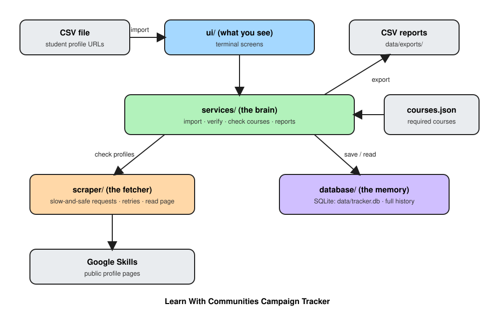

# Learn With Communities Campaign Tracker

A small app that runs in your terminal. You give it a list of student **Google Skills profile links**.
It opens each public profile, checks which required courses are done, saves the result, and gives you reports.

## How it works



Editable version: [`docs/architecture.excalidraw`](docs/architecture.excalidraw) (open it at [excalidraw.com](https://excalidraw.com)).

- **ui** – the screens you click through.
- **services** – the brain: imports the CSV, runs checks, makes reports.
- **scraper** – fetches profile pages slowly and safely.
- **database** – remembers every result in a local file (`data/tracker.db`).

## Install

You need **Python 3.11 or newer**.

**Windows (PowerShell)**
```powershell
python -m venv .venv
.venv\Scripts\Activate.ps1
pip install -r requirements.txt
```

**Linux / macOS**
```bash
python3 -m venv .venv
source .venv/bin/activate
pip install -r requirements.txt
```

Optional, Linux only: `apt install python3-tk` gives you the normal file-open window for **Browse**.
Without it, Browse uses a simple picker inside the terminal. Everything else works.

## Run

```bash
python main.py
```

## Your CSV file

One column, with this exact header on the first line:

```
Google Skills Profile URL
https://www.skills.google/public_profiles/<profile-id>
```

Blank lines are skipped. Wrong links are listed with the reason. The same link twice is saved once.

## What each feature does

| Screen | Key | What it is for |
|---|---|---|
| Dashboard | `1` | Totals: completed, incomplete, failed, not found, needs review |
| Import CSV | `2` | Load students. `F3` Browse, `F4` Preview, `F5` Import |
| Verify all students | `3` | Check everyone |
| Verify incomplete | `4` | Re-check only students who were missing courses |
| Retry failed profiles | `5` | Try again the ones that failed for technical reasons |
| Student directory | `6` | Every student and their latest result |
| Inaccessible profiles | `7` | Private or missing profiles |
| Failed records | `8` | Technical failures. Press `D` for details |
| Needs-review records | `9` | Unclear results. Press `P` to mark one as private after you checked it yourself |
| Course-wise progress | `c` | How many students finished each course |
| Export reports | `e` | Save 5 CSV reports to `data/exports` |
| Settings | `s` | See current settings |

Other keys: `r` refresh, `F2` diagnostics, `q` quit.

**Results you will see**

- **Completed** – all required courses done.
- **Incomplete** – profile read, some courses missing.
- **Private / inaccessible** – the student must make the profile public.
- **Not found** – the link does not exist. Ask for the right link.
- **Failed** – network or server problem. Retry later.
- **Needs review** – unclear result. Check the link in a browser.

Failed, private, not-found and needs-review students are **never** counted as incomplete.
Every check is kept in the history; nothing is overwritten.

## Rate limiting (how fast it asks Google)

To be polite and avoid getting blocked, the app is slow on purpose:

- **1 request every 2 seconds**, one at a time.
- If a check fails, it waits a little longer each time and tries again (up to 2 retries).
- If Google says "too many requests" (HTTP 429), it pauses and obeys the wait time Google gives.
  If that keeps happening, the run stops safely.
- It only reads public pages. It never logs in and never tries to get around blocks.

- **Up to 5 requests per second** (one every 0.2 seconds, 2 at a time).
- If a check fails, it waits a little longer each time and tries again (up to 2 retries).
- If Google says "too many requests" (HTTP 429), it pauses and obeys the wait time Google gives.
  If that keeps happening, the run stops safely.
- It only reads public pages. It never logs in and never tries to get around blocks.

**Slow it down:** copy `.env.example` to `.env` and add:

CT_REQUEST_DELAY_SECONDS=2     # seconds between requests (higher = slower)
CT_MAX_CONCURRENCY=1           # requests at once (1 to 3)

## Reports

Press `e`, then the export button. Files go to `data/exports/` (change with `CT_EXPORT_DIR` in `.env`).
Old files are never overwritten (you get `name_1.csv`, `name_2.csv`, …).

| File | What is inside |
|---|---|
| `student_summary` | One row per student: status, courses done and missing, % |
| `course_report` | One row per course: how many done and missing |
| `missing_certifications` | Which courses each student still needs |
| `failed_profiles` | Profiles that could not be checked, and why |
| `campaign_summary` | Overall totals |

Reports use each student's **latest** check. If the latest check did not read the profile, course counts are blank, not 0.

## Fixing problems

| Problem | What to do |
|---|---|
| App will not start | Check `campaign/courses.json` and your `.env` values |
| Many "Failed" results | Wait a while, then use **Retry failed profiles** (`5`) |
| Profile shows "Needs review" | Open the link in a browser. If it is private, press `P` on that screen |
| Browse opens a terminal picker | tkinter is missing (see Install), or just paste the file path |
| Export error | The output folder is not writable. Set `CT_EXPORT_DIR` |
| Need more detail | Press `F2`, or read `data/tracker.log` |

## Tests

```bash
pytest
```

Tests use fake data and a temporary database. They never touch the internet.

## Limits

- It depends on how Google Skills pages look today. If they change, results may become "Needs review" or "Failed" instead of wrong numbers.
- It cannot read pages that need JavaScript to load.
- Private and missing profiles can look the same to the app, so some need your manual check.
- It is for one person on one computer.
- Reports are CSV only.

## Folders

```
campaign/   required courses (courses.json)
core/       settings and shared basics
database/   saving and reading data
scraper/    fetching and reading profile pages
services/   import, verify, reports, export
ui/         terminal screens
tests/      automated tests
data/       your database, log, exports (not committed)
```